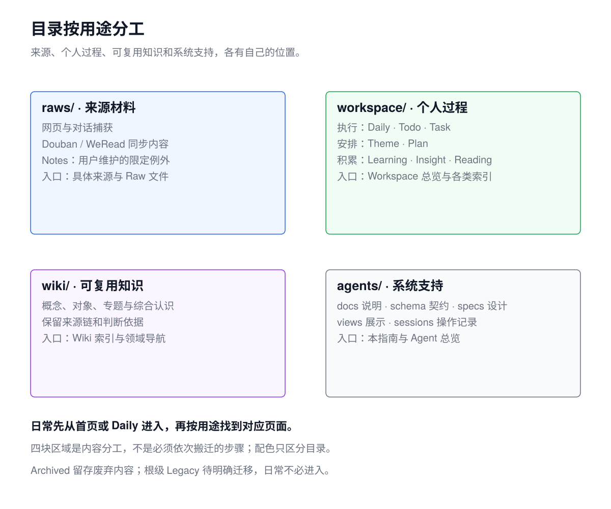
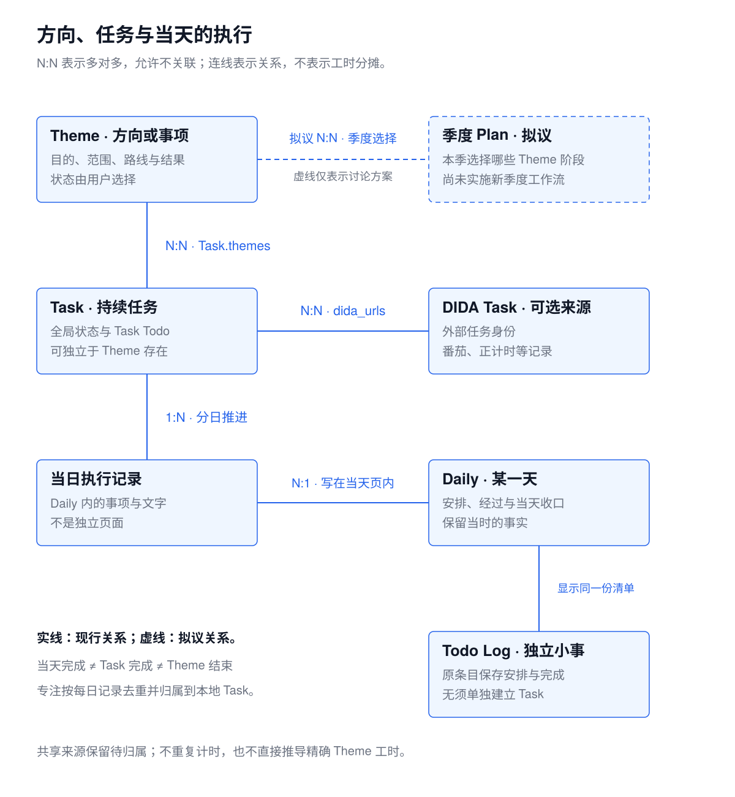
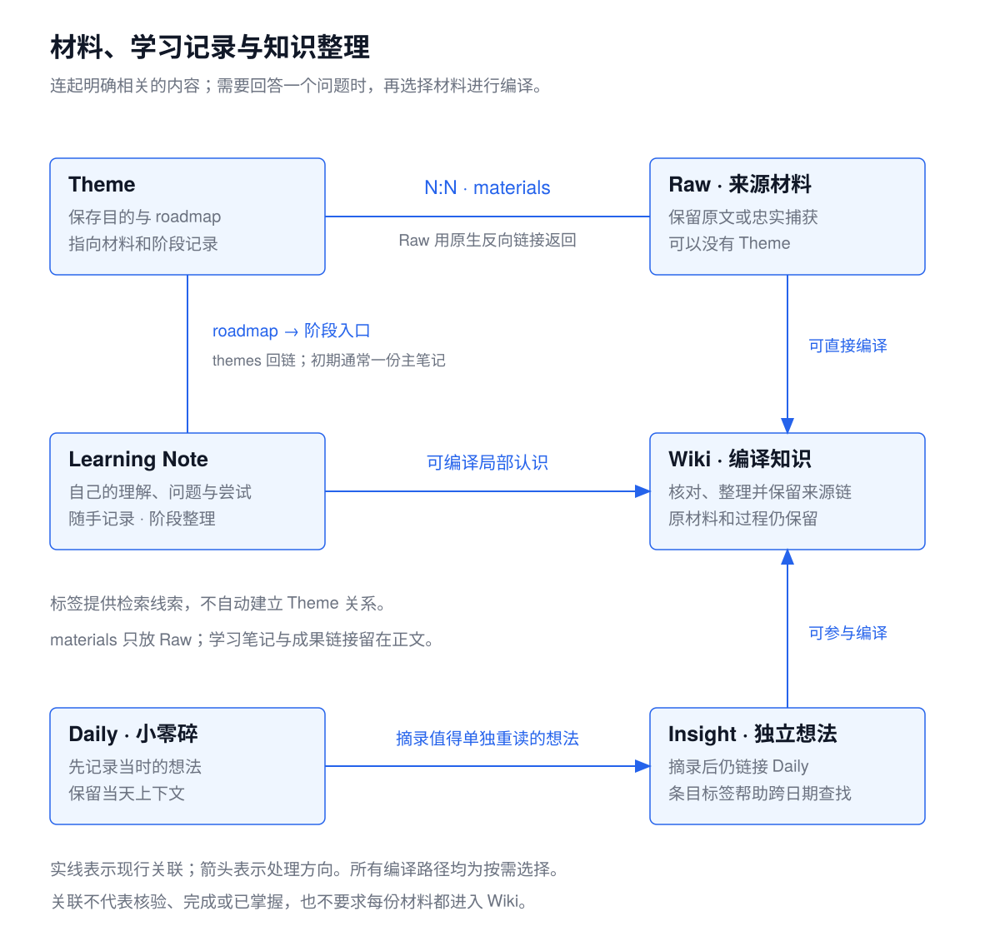

# 这个知识库怎么用

日常从 Daily 开始：小事记 Todo，需要持续推进的事建 Task，值得独立规划的方向或事项设为 Theme。资料先保存，等有明确问题时再整理成知识。

> 阅读约 5 分钟。本文帮助理解用法，具体约定以 [[agents/schema/README|Schema]] 为准。季度中心的 Plan 仍是拟议设计。

跳转：[[#目录为什么这样分|目录分工]] · [[#计划与执行如何连接|任务关系]] · [[#材料如何变成自己的知识|材料与知识]] · [[#遇到一件事应该放哪里|场景速查]] · [[#两个贯穿示例|使用示例]]

## 从哪里开始使用

打开 [[agents/views/overview/home|首页]] 看当天记录与待办；找某类内容时，去 [[workspace/README|Workspace 总览]] 或 [根目录入口](../../README.md)。

- **开始一天**：在 Daily 选出今天要推进的任务步骤，安排少量小事。
- **做事时**：进展记在对应事项下，临时想法记“小零碎”；学习时从 Theme 的 roadmap 进入阶段笔记。
- **结束一天**：记录实际结果，把后续步骤留在 Task 的 Todo，必要时摘录 Insight。

Daily 关闭表示当天复盘结束，不代表所有任务完成。历史 Daily 保留当时事实，不随任务后来的状态改写。

## 目录为什么这样分

[查看 PNG 预览](_assets/vault-guide/directory-map.png)

四个目录按用途分工：**Raw 留来源，Workspace 记自己的过程，Wiki 存可复用的知识，Agents 管系统规则与工具。** 不要求内容依次搬过四个目录。

Workspace 的常用子目录：

| 用途 | 目录 |
|---|---|
| 日常执行 | `daily/`、`todos/`、`tasks/` |
| 方向与周期安排 | `themes/`、`plans/` |
| 学习与想法 | `learning/`、`insights/` |
| 阅读与观看记录 | `reading/`、按需使用的 `viewing/` |

Raw 默认只读，尤其是插件同步内容；用户维护的 `raws/Notes/` 按既有规则保留。新的 Theme 学习笔记放在 `workspace/learning/`，不自动迁移旧笔记。PDF 可以留在 Zotero，通过链接引用。

`archived/` 保存废弃内容，根级 `legacy-*` 留待明确迁移，日常不必进入。系统说明与规则分别在 `agents/docs/`、`agents/schema/`；Agent 草稿不等于已确认结论。

## 计划与执行如何连接

[查看 PNG 预览](_assets/vault-guide/task-relations.png)

| 对象 | 负责什么 |
|---|---|
| Theme | 一个方向或阶段性事项的目的、范围、roadmap 与结果 |
| Plan | 一个周期选择投入什么，以及后来的复盘 |
| Task | 目标、明细表与全局状态；完成日期可跳到当天复盘 |
| Todo | 一行能说清的独立小事，如购票、办手续 |
| Daily | 今天的安排、执行记录、想法与复盘 |
| DIDA Task | 滴答中的外部任务及番茄、正计时来源 |

**关联看图，使用时记住四点：**

- Theme–Task、Task–DIDA Task 都是 **N:N**，分别由 Task 的 `themes`、`dida_urls` 维护。Task 可以没有 Theme，也可以不绑定滴答。
- Daily 可以直接手写，review 时由 Agent 补齐 Task 表格与明细回链；“当日执行记录”不是独立页面。小任务视图操作同一份 Todo 原条目，不另抄一套。
- 当天完成、Task 完成、DIDA 完成和 Theme 结束各自独立。Theme 的开始、暂停、结束由你决定。
- 专注按每日记录去重、归属到 Task；共享来源不重复计时，无法判断时保留待归属。多对多关联不能直接算出精确的 Theme 工时。

**Plan 的边界：**现行 Schema 仍保留周、月、季度页，旧三份草案已清理。拟议方案是以季度选择已有 Theme 的推进阶段，月度总结和调整；Theme 可跨季度，所以 Plan–Theme 整体为 N:N。这套季度工作流尚未落地，图中用虚线标明。

## 材料如何变成自己的知识

[查看 PNG 预览](_assets/vault-guide/knowledge-flow.png)

**Raw：保存材料，明确有关再关联。** 标签用于宽松检索；确定服务某个已有 Theme 后，把完整 Raw 链接加入该 Theme 的 `materials`。两者是 N:N，只维护 Theme 一侧，不改 Raw。Raw 的原生反向链接能找到引用它的页面，但正式材料关系仍以 `materials` 为准。

**Learning Note：沿路线记录自己的理解。** 确认新学习 Theme 和 roadmap 后，同次生成主学习笔记，Theme 链接各阶段入口。每阶段保留“随手记录”和“阶段整理”，笔记用 `themes` 回链。`materials` **只放 Raw，不能放学习笔记**；成果和外部链接放正文。只讨论既有 Theme 不会自动建笔记，空骨架也不代表学习进度。

**Insight：留住值得再读的想法。** Daily 里的疑问、判断或发现，可以摘到月度 Insight，保留上下文、标签与 Daily 来源。

**Wiki：围绕问题整理可复用的认识。** 编译时先查明确关联的材料，再用标签、关键词和相关记录补充，核对说法并保留来源。没有 Theme 的 Raw 也能直接参与，不必等整个 Theme 完成。原文与过程记录继续保留；建立关联不代表已经核验、掌握或必须编译。

## 遇到一件事应该放哪里

| 遇到的事 | 放哪里 |
|---|---|
| 收藏文章或对话 | Raw；明确相关时加入 Theme 的 `materials` |
| 零碎想法或疑问 | Daily“小零碎”；值得重读时摘为 Insight |
| 买东西、办手续 | Todo；只是要等几天，不必升级为 Task |
| 需要多次推进的实现或调查 | Task，Daily 记当天进展 |
| 系统学习一个方向 | 确认 Theme 与 roadmap，生成学习笔记和阶段入口 |
| 筹划一次旅行 | 值得独立规划时设 Theme，准备工作用 Task 或 Todo |
| 读书摘抄和评论 | Reading Note，引用书籍来源 |
| 整理可反复查阅的认识 | 编译为 Wiki，保留证据与来源 |

拿不准时，先放在能找回上下文的地方；需要独立检索或反复维护时再拆页。

## 两个贯穿示例

以下仅为示意，不代表已经创建页面或安排了个人计划。

**学习一个技术方向**：确认目的与 roadmap → 建立学习 Theme 和主笔记 → Raw 放资料、`materials` 建关联，学习笔记记试验与理解 → 持续验证用 Task，Daily 记当天进展 → 有稳定认识的局部问题先编译为 Wiki。

**准备一次旅行**：Theme 写目的、预算、约束和路线 → 攻略作为相关 Raw → 多轮比较用 Task，购票等小事用 Todo → Daily 记录准备进展 → 旅行后回看经验，由自己决定结束 Theme。旅行不需要生成学习笔记，也不要求产出 Wiki。

## 当前做到哪里

上面的目录、任务、材料关联和学习笔记机制已有规则与入口；**季度中心 Plan 仍待设计**。

具体约定：[[agents/schema/page-types/theme|Theme]] · [[agents/schema/workflows/learning|学习记录]] · [[agents/schema/workflows/daily|Daily]] · [[agents/schema/workflows/compile|知识编译]] · [[agents/schema/page-types/period-plan|现行周期页]]。

整库由 OneDrive 同步；Git 只保存白名单中的开发资产，不是个人笔记的完整备份。

## 按周期关注一组任务

在 Daily 任务池点击“创建关注组”，填写名字和周期，再选入已有 Task。季度 LIFE 和工作版本迭代可以同时各有一组；当前组展开在上方，全量任务池折叠在下面，没有当前组时全量展开。也可以从 [[workspace/task-groups/_Index|任务关注组]] 统一管理。

未分组任务仍可安排进 Daily，也照常自动续入。关注结束时点“关闭组”，组记录和成员保留，任务本身不会一起完成。预计结束日期只作提醒。

今日开放页保存当天最新的关注范围；过了当天或完成复盘后，Daily 使用已保存的组名和成员记录。旧 Daily 没有分组记录时保留原任务池，不用现在的分组倒推。
